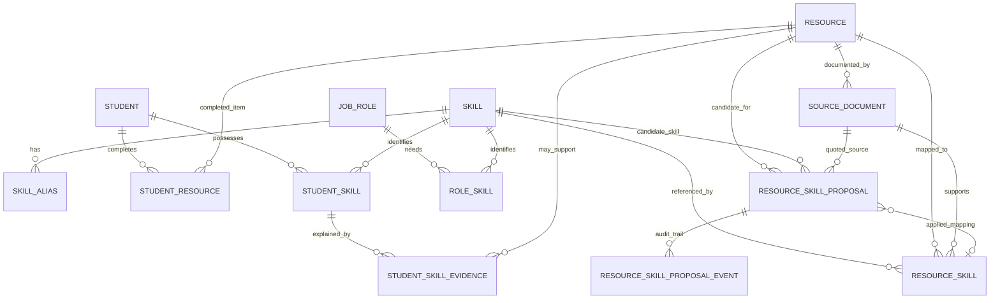
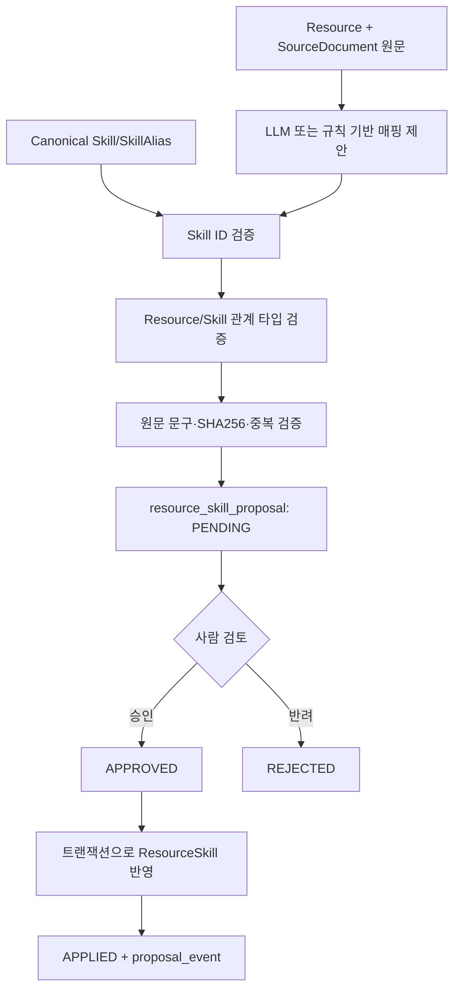
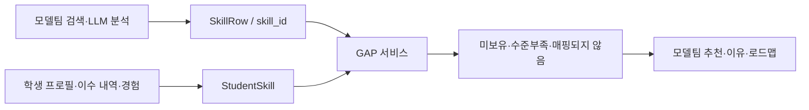

# CareerQuest — 중간발표용 DB·백엔드 기술 정리

> 기준: 2026-11-20, 로컬 PostgreSQL `careerquest` 및 사용자 실행 로그. 2026-11-24 중간발표 준비용.
>
> 이 문서는 **이미 구현·검증된 항목**과 **아직 구현되지 않은 항목**을 구분한다. 로컬 테스트 통과는 운영 서비스 보안·실시간 HTTP E2E 검증을 의미하지 않는다.

## 1. 담당 범위와 설계 원칙

- **DB/백엔드:** 정형 데이터 저장 및 정합성, Canonical Skill/SkillAlias, ResourceSkill 매핑 제안 검증·승인·반영, StudentSkill·RoleSkill 관리, GAP 계산, 관련 API.
- **모델팀:** LLM 기반 Skill 추출, RAG 검색/근거 수집, SkillRow 생성, 추천·우선순위·근거·로드맵.
- **중요:** 모델의 실시간 SkillRow가 반드시 ResourceSkill 테이블에 저장되는 것은 아님. 오프라인 지속형 매핑 승인 흐름과 실시간 추천 분석 흐름은 별도.
- **데이터 처리 원칙:** 모델이 `skill_id`를 임의로 생성하지 못하도록 Canonical Skill DB 검증; `confidence`만으로 승인하지 않음; 승인된 매핑을 실제 분석에 이용; 변경 기록 보존.

## 2. 주요 DB 테이블 및 관계



위 그림에서 `student_skill_evidence`의 경험 근거 등 일부 선택적 외래키와 `resource_job_role` 등의 보조 연결 테이블은 가독성을 위해 생략하였다. 전체 스키마를 그대로 재현한 완전한 ERD가 아니라 **Skill·GAP 관련 핵심 개념 ERD**다.

**테이블별 역할**

| 테이블 | 역할 | 핵심 제약·상태 |
|---|---|---|
| `skill` / `skill_alias` | 표준 Skill 및 표기 변형 | 정규화된 이름의 UNIQUE 인덱스 |
| `resource` / `source_document` | 공고·수업·자격증·프로그램과 수집 원문 | 원문 SHA256, 원문 검증 상태, Resource 연결 |
| `resource_skill` | 승인 또는 검증 상태가 구분되는 지속형 매핑 | `(resource_id, skill_id, relation_type)` UNIQUE; `verified` |
| `resource_skill_proposal` | 신규 매핑/기존 매핑 확인·관계 변경의 제안 대기 | `PENDING`, `APPROVED`, `REJECTED`, `APPLIED`; `submission_key` UNIQUE; 원문 SHA256 |
| `resource_skill_proposal_event` | 제출·승인·거절·적용 이력 | 제안 ID에 따른 사건 기록 |
| `student_resource` / `student_skill` / `student_skill_evidence` | 학생 이수 및 보유 역량·근거 | `(student_id, skill_id)` UNIQUE; 근거 정책 적용 |
| `role_skill` | 직무별 요구 Skill 집계 | `(job_role_id, skill_id)` UNIQUE; 과거 행의 원본 이력은 미기록 |

## 3. 데이터 흐름

### 3.1 지속형 Skill 매핑(백엔드 저장 경로)



**구현·테스트된 특성**: 중복 제출 멱등성, 같은 Resource/Skill의 상충 제안 차단, 승인 전 적용 차단, 원문 변경 검출, 재적용 멱등성, 원자적 롤백, 이벤트 기록. 실제 운영자 신원 인증은 아직 미구현.

### 3.2 실시간 GAP 경로(모델팀 연동)



- `SkillRow.skill_id`는 실제 활성 Skill ID여야 함. 미매핑 줄은 `skill_id=null` 및 `skill` 명칭 포함.
- GAP 서비스는 **보유 역량을 기본 응답에서 제외**하고 `미보유`, `수준부족`, `매핑되지 않음`만 반환함. 모델팀은 반환되지 않은 매핑된 항목을 보유로 해석한다.
- ResourceSkill의 `verified`(매핑 승인)와 StudentSkill의 `verified`(학생 역량 자체의 검증 상태)는 다른 의미임.

## 4. 2026-11-20 기준 로컬 DB 현황

| 항목 | 확인 수량 | 참고 |
|---|---:|---|
| Resource | 10,993 | 이 수치가 전체 채용공고를 최신 상태로 보증하지는 않음 |
| SourceDocument | 11,781 | 수집한 원문 |
| Skill | 245 | 활성 여부 세분화 이전의 전체 테이블 행 수 |
| SkillAlias | 162 | 표기 연결 |
| ResourceSkill | 869 | 과거 미승인 연결 다수 포함 |
| StudentSkill | 8 | 테스트 학생 등 현재 로컬 데이터 |
| StudentSkillEvidence | 8 | 보유 근거 |
| RoleSkill | 38 | **과거 저장 출처·검수 이력이 확인되지 않음** |
| ResourceSkillProposal | 0 | 신규 대기열 구현됨; 테스트 롤백으로 행 없음 |
| ResourceSkillProposalEvent | 0 | 신규 이력 테이블 구현됨 |

수량은 사용자 실행 `python -m backend_regression_v1_4.run --student-id 1` 로그 기준이며, 이후 DB 변경 시 다시 산출해야 한다.

## 5. 검증 결과

| 검증 묶음 | 결과 | 범위 |
|---|---|---|
| 제안 계약 단위 테스트 | 17/17 PASS | 제안 입력, 근거 검사, 정책 |
| 재요청·중복 처리 단위 테스트 | 8/8 PASS | 멱등성·예외 처리 |
| API 계약 단위 테스트 | 13/13 PASS | GAP 응답·HTTP 422/500·기존 경로 |
| 전체 회귀 검사 | 13/13 PASS | 구조·신뢰정책·RoleSkill 가드·GAP·API |
| 로컬 DB 승인 트랜잭션 롤백 | PASS | PENDING→APPROVED→APPLIED 및 이벤트, 테스트 후 롤백 |
| 로컬 DB 실패 경로 테스트 | PASS | 원문 변경·중복·충돌·승인 전 적용·재적용·잠금 |
| 회귀 검사 전후 행 수 | 동일 | 행 수 불변 확인; **내용 전체 해시 비교는 아님** |

**회귀 검사 실행 명령:**

```powershell
python -m backend_regression_v1_4.run --student-id 1
```

**리포트:** `$env:USERPROFILE\CareerQuest_Backups\Backend_Regression\backend_regression_20261120_123135_utc.json` (사용자 실행 로그의 로컬 파일; 공유·커밋 전에 개인정보 점검).

## 6. API 경계·현재 한계

- 유지 중인 FastAPI 경로: `/health`, `/api/skills`, `/api/students`, `/api/students/{student_id}/skills`, `/api/gap/calculate`, `/api/gap/contract` 등.
- GAP 계약은 OpenAPI 및 Pydantic으로 검증. 실패 입력 422 / 서버 DB 오류 500, **내부 SQLAlchemy 오류 상세를 API 응답에 노출하지 않도록 수정**.
- **현재 미완료 사항**:
  1. 학생 식별·조회 API에 인증 및 학생별 접근 권한(RBAC/인가) 적용: 현재 미구현. **외부 공개 금지**.
  2. 검토자 식별을 단순 문자열이 아니라 인증된 행위자로 연결: 현재 미구현. 승인 관리 엔드포인트를 무인증으로 노출하면 안 됨.
  3. 과거 `role_skill` 38건의 출처·검수 이력: 현재 미기록. 검증된 추천 근거로 확정 표시 불가.
  4. StudentSkill 중 근거 기록이 전혀 없는 직접/프로필 입력: 현재 보유로 간주되는 정책. 출처/신뢰 수준 분리 필요.
  5. 실제 서버를 통한 종단 간 HTTP E2E 및 여러 프로세스의 동시 승인 경합 테스트: 이번 회귀 검사에서 미실시. DB 행 잠금·롤백 개별 테스트와 구분 필요.
  6. RAG 색인·검색 품질: 모델팀 담당. 별도 평가 필요.

## 7. 중간발표에서 강조할 핵심

> "CareerQuest 백엔드는 정형 데이터를 단순 저장하는 수준을 넘어, 표준 Skill 사전과 근거 원문을 바탕으로 LLM 매핑 제안을 검증·승인·감사하는 구조를 구현했습니다. StudentSkill과 RoleSkill의 미승인 매핑 혼입을 통제하고, 모델팀 SkillRow와의 GAP 계산 API를 실제 로컬 PostgreSQL과 단위 테스트로 검증했습니다. 현재는 시연 가능한 핵심 백엔드 구조가 마련됐으며, 인증·인가와 운영 환경 검증, 원문/추천 품질 평가는 후속 과제입니다."

### 발표 슬라이드용 추천 4장

1. **DB/서비스 아키텍처:** `Resource → SourceDocument → Proposal → ResourceSkill → StudentSkill/RoleSkill → GAP`.
2. **무결성 설계:** UNIQUE/FK, 원문 SHA256, 승인 상태 머신, 이벤트 이력, 중복 처리, 트랜잭션 롤백.
3. **검증 결과:** 단위 테스트 38개 + 회귀 항목 13개 PASS; 실제 DB 실패 경로 및 롤백 결과.
4. **한계와 후속 개발:** 인증·인가, 출처 관리, StudentSkill 프로필 신뢰정책, 실HTTP E2E, RAG 색인/품질은 모델팀.

## 8. 발표 전 안전한 Git 체크

기존 `git status`에 `eval_pack` 등이 일부 스테이징된 상태였으므로 무조건 `git add .`나 `git commit -am ...`을 사용하지 않는다.

```powershell
git branch --show-current
git status --short
git diff --cached --name-only
python -m backend_regression_v1_4.run --student-id 1
```

백엔드 코드는 선택적으로 검토 후 커밋. 비공개 원문·수집 리포트·DB 덤프·사용자 입력·API 키가 포함된 파일 및 `CareerQuest_Backups`는 GitHub에 업로드하지 않는다.

---

**상태:** 중간발표용 백엔드 회귀 테스트 통과. 공개 배포 준비 완료는 아님.
